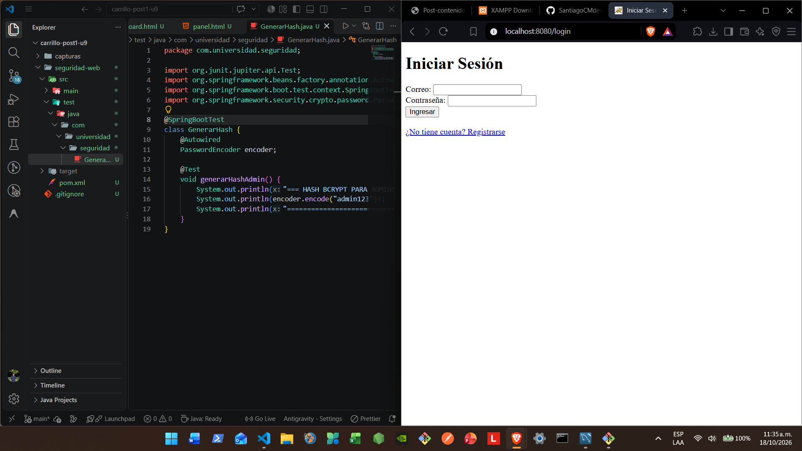
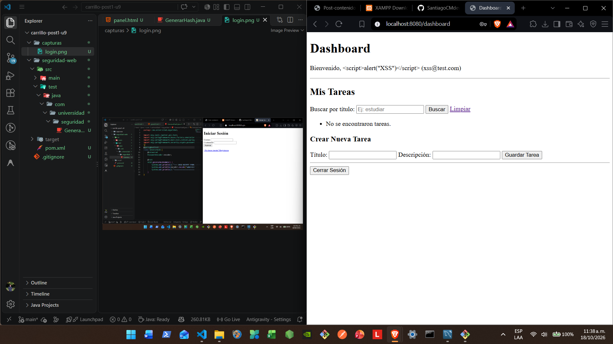
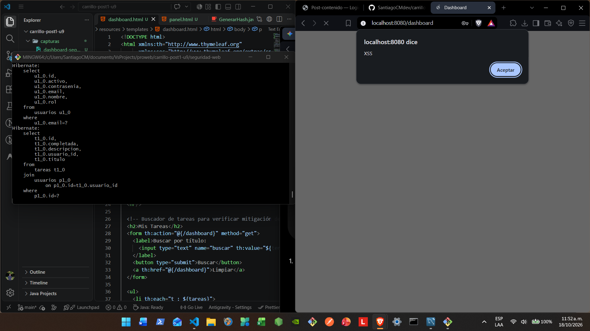
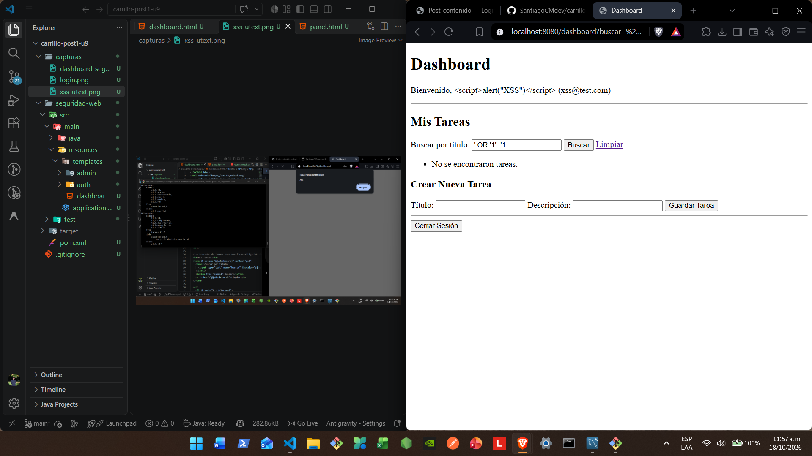
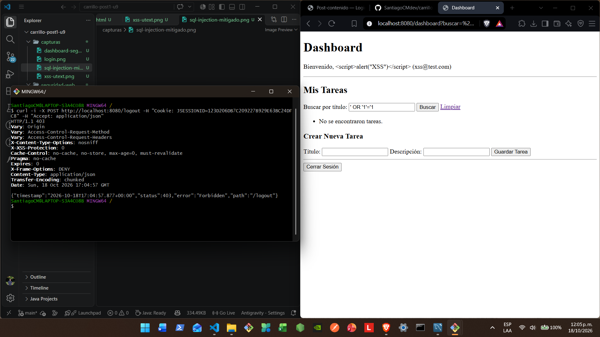
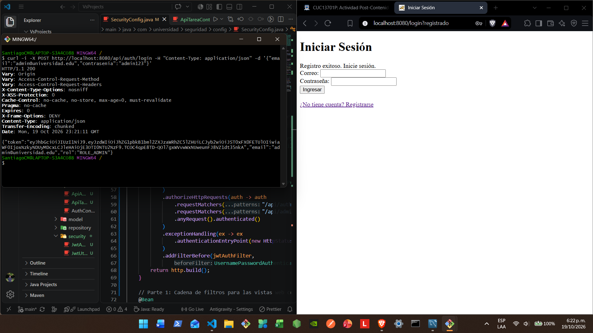
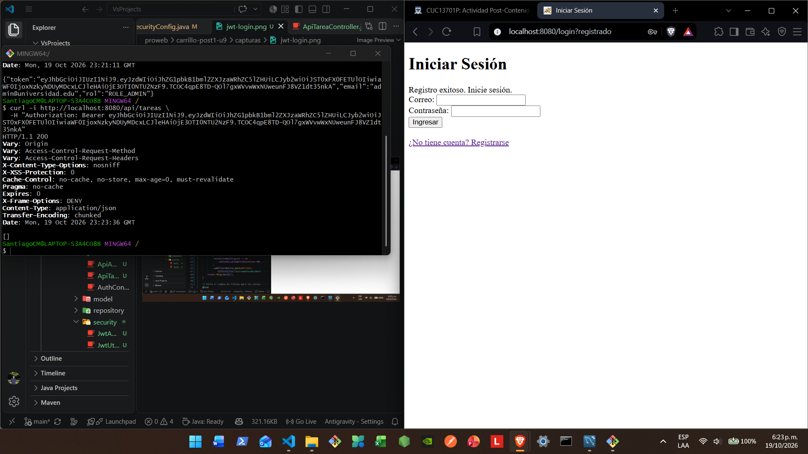
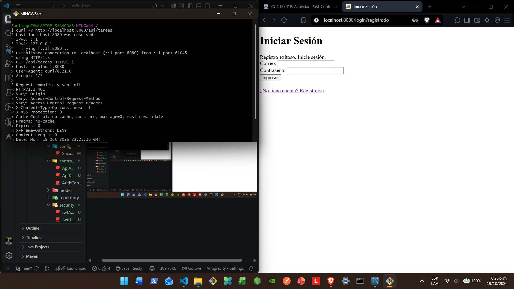

# Post-contenido - Unidad 9: Seguridad en Aplicaciones Web

**Estudiante:** Santiago Eduardo Carrillo Molina  
**Código:** 02230132036  

## Descripción
Repositorio del laboratorio de la Unidad 9 de Programación Web - Séptimo Semestre. Contiene un único proyecto Maven Spring Boot (`seguridad-web/`) con dos mecanismos de autenticación coexistiendo: sesión (Spring Security form-login) para las vistas Thymeleaf, y JWT stateless para la API REST bajo `/api/**`.

## Parte 1 - Login con Sesión, BCrypt, Roles y Mitigación Activa
`SecurityConfig` define `webFilterChain` (`@Order(2)`, `securityMatcher("/**")`) con form-login, `BCryptPasswordEncoder` y autorización por rol.
- **Mitigación de XSS:** Se demuestra activamente contrastando `th:text` (seguro, escapa etiquetas HTML como `&lt;script&gt;`) con `th:utext` (inseguro, interpreta el script en el navegador) sobre el nombre del usuario autenticado.
- **Mitigación de SQL Injection:** En `TareaRepository` se utiliza `@Query` parametrizado con `:texto`, lo cual ejecuta un `PreparedStatement` seguro donde entradas como `' OR '1'='1` se tratan como texto literal. Si se hubiera utilizado la versión concatenada comentada en el repositorio, la condición siempre verdadera habría devuelto todas las tareas de todos los usuarios sin filtrar.
- **Mitigación de CSRF:** Permanece activa en la cadena de sesión; cualquier petición `POST` a `/logout` sin el token CSRF generado por Thymeleaf es rechazada con `403 Forbidden`.

## Parte 2 - API REST Stateless Protegida con JWT
`SecurityConfig` agrega `apiFilterChain` (`@Order(1)`, `securityMatcher("/api/**")`), stateless (`SessionCreationPolicy.STATELESS`), con CSRF desactivado SOLO en esta cadena porque no depende de cookies. `JwtUtil` genera y valida el token (firma HMAC + expiración de 1 hora); `JwtAuthFilter` (`OncePerRequestFilter`) lo valida en cada petición a `/api/**` y puebla el `SecurityContext` manualmente, sin consultar la base de datos en cada request.

## Por qué dos mecanismos en el mismo proyecto
Las vistas Thymeleaf sirven a un navegador con cookie de sesión: CSRF debe seguir activo ahí. La API sirve a clientes sin cookies (app móvil, SPA externa, integración de terceros): un token autocontenido en el header `Authorization` resuelve ese caso sin depender de estado en el servidor. Ningún mecanismo reemplaza al otro; cada uno cubre un tipo de cliente distinto del mismo sistema.

## Nota de seguridad para producción
La clave HMAC de `JwtUtil` está hardcodeada únicamente para simplificar este laboratorio. En un proyecto real debe leerse de una variable de entorno o de un gestor de secretos: cualquiera con acceso al código fuente podría firmar tokens válidos si la clave queda expuesta en el repositorio.

## Cómo compilar y ejecutar
1. Clonar el repositorio: `git clone https://github.com/TU_USUARIO/carrillo-post1-u9.git`
2. Crear la base de datos `seguridad_db` en MySQL
3. Configurar `seguridad-web/src/main/resources/application.properties` con las credenciales de MySQL
4. Insertar un usuario `ROLE_ADMIN` siguiendo la Parte 1, Paso 8
5. Ejecutar `mvn spring-boot:run` dentro de `seguridad-web/`
6. Vistas web: `http://localhost:8080/login`
7. API: `POST http://localhost:8080/api/auth/login`

## Capturas de pantalla

